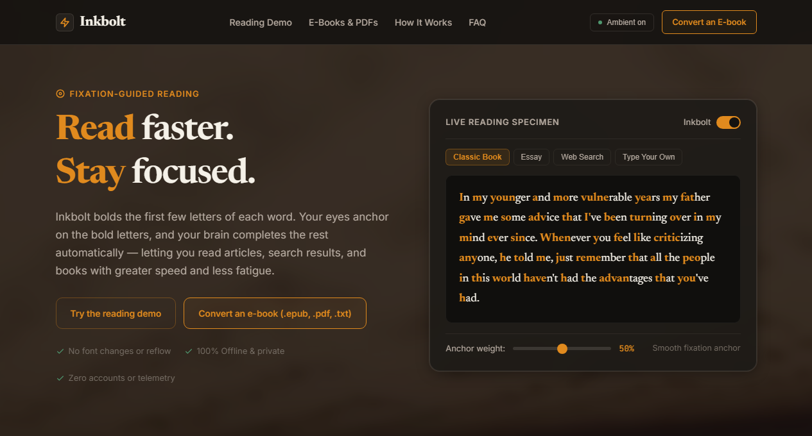
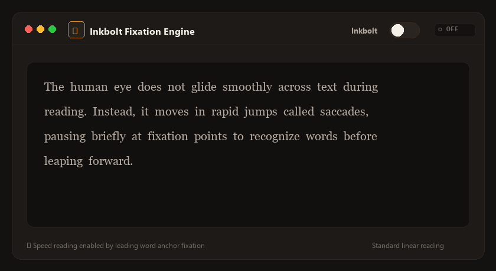
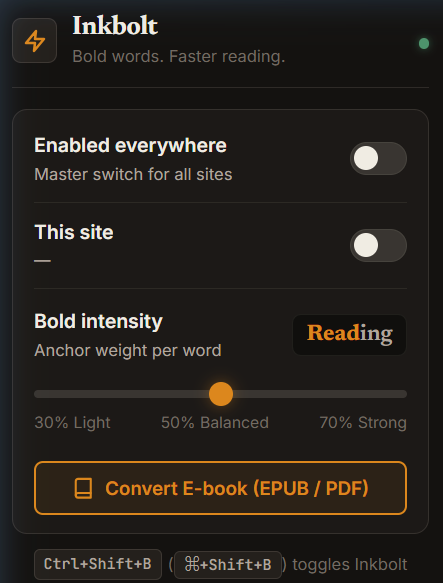
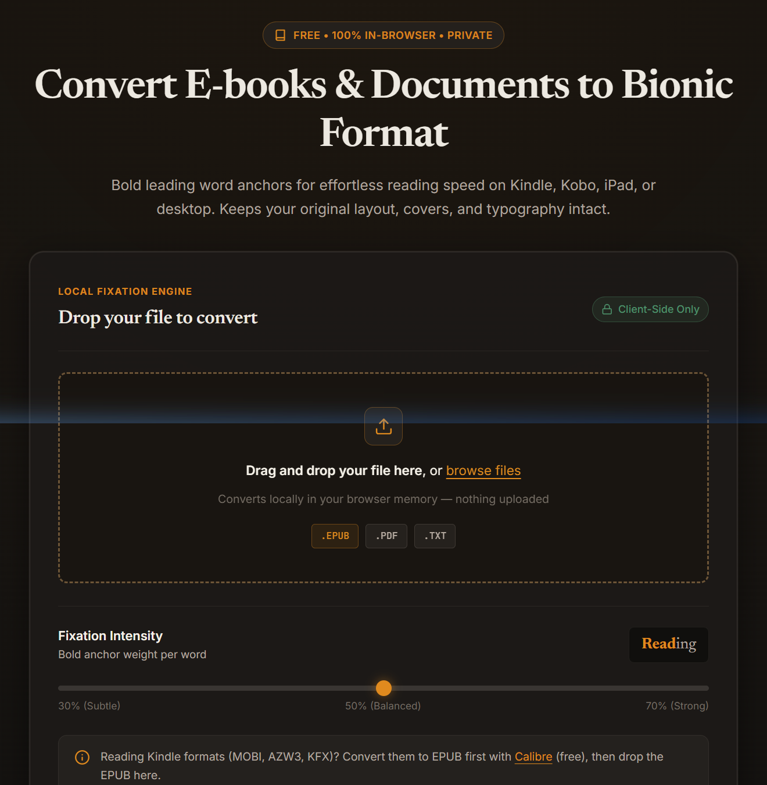
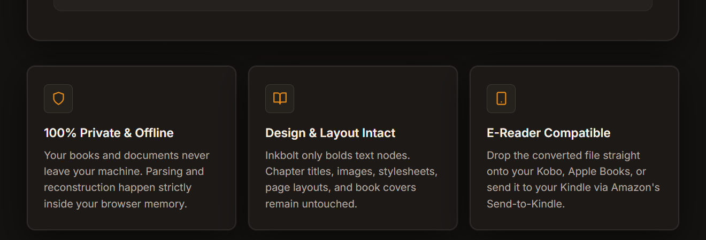

<div align="center">


# Inkbolt

**Bold words. Faster reading. Deeper focus.**  
Read websites, articles, and e-books up to 2× faster with bionic fixation anchors — 100% offline & private.

[**Chrome Web Store**](https://chromewebstore.google.com/detail/inkbolt/jokidopffoajcbbomjphgbdmfbpeflen) • [**Firefox Add-ons**](https://addons.mozilla.org/firefox/addon/inkbolt-read-faster/) • [**Features**](#features) • [**E-Book Converter**](#the-e-book--document-converter) • [**Install**](#install--quick-start) • [**Build from Source**](#build-from-source)

<br>



</div>

> **How it works:** Inkbolt bolds the leading letters of every word across the web and inside your e-books. Your eyes latch onto anchor fixation points (saccades), your brain effortlessly fills in the rest, and you glide through long-form reading with less eye fatigue and deeper comprehension. No accounts, no cloud servers, zero telemetry — everything runs 100% locally in your browser memory.

<div align="center">



</div>

---

## Why Inkbolt

- **Zero Layout Shifts.** Only `font-weight` changes — ever. Font-family, font-size, line-height, margins, and page styling remain untouched.
- **Works on Dynamic Live Content.** Infinite-scroll feeds, SPAs, and search engines — Inkbolt formats newly loaded text in real time without requiring a refresh.
- **Built-in Offline E-Book Converter.** Transform `.epub`, `.pdf`, and `.txt` files directly in your browser with layouts, chapters, images, and covers 100% intact.
- **Private by Design.** Zero network calls, zero tracking, no telemetry. Your files, documents, and settings never leave your machine.
- **E-Reader Ready.** Sideload converted EPUBs straight onto your Kindle (via *Send to Kindle*), Kobo, Apple Books, or reMarkable tablet.
- **Icon-Font Protection.** Automatically detects and skips icon fonts (Font Awesome, Material Icons, Feather, etc.) so web icons never turn into garbled text.

---

## Features

### The Browser Extension
A clean, lightweight extension for Chromium (Chrome, Edge, Brave, Opera) and Firefox.
- **Master switch:** Toggle Inkbolt globally on or off with a single click.
- **Per-site toggle:** Disable Inkbolt on specific domains (e.g. code sandboxes or spreadsheets) while keeping it active everywhere else.
- **Bold Intensity Slider:** Tune fixation anchor weight from **30% (Subtle)** to **50% (Balanced)** up to **70% (Deep)** with live preview.
- **Global Hotkey:** Press <kbd>Ctrl+Shift+B</kbd> (<kbd>⌘+Shift+B</kbd> on macOS) to instantly toggle reading mode on any page.

### The E-Book & Document Converter
Accessible directly from the extension popup or as a standalone web tool.
- **EPUB Novels & Non-Fiction (`.epub`):** Parses chapters with JSZip, bolds text nodes in-place, and re-packages a standard EPUB. Covers, metadata, embedded stylesheets, and illustrations stay pixel-perfect.
- **PDF Documents (`.pdf`):** In-place text overlay via `pdf-lib` and `pdf.js`. Preserves original tables, diagrams, headers, and vector graphics.
- **Plain Text Files (`.txt`):** Generates true Unicode Mathematical Bold characters so the output remains a genuine, portable `.txt` file.

---

## Screenshots

| Browser Extension Popup | Offline E-Book Converter Tool |
|:---:|:---:|
|  |  |

<br>

<div align="center">

### Built for complete privacy and e-reader compatibility



</div>

---

## Supported Formats

| Format | Input | Output | Highlights |
|---|---|---|---|
| **Web Pages** | HTML DOM | Formatted DOM | Real-time DOM transform, MutationObserver, icon-font protection |
| **E-Books** | `.epub` | `.epub` | Preserves cover art, CSS stylesheets, tables, and chapter structure |
| **Documents** | `.pdf` | `.pdf` | Exact page layout preserved; bold anchors rendered in-place |
| **Plain Text** | `.txt` | `.txt` | Uses genuine Unicode bold characters without adding markup |
| **E-Readers** | Kindle, Kobo, Boox | `.epub` | Compatible with Amazon Send-to-Kindle, Apple Books, and Kobo |

---

## Install & Quick Start

### 1. Browser Extensions

- **Chrome / Brave / Edge:** Install directly from the [Chrome Web Store](https://chromewebstore.google.com/detail/inkbolt/jokidopffoajcbbomjphgbdmfbpeflen).
- **Firefox:** Install directly from [Firefox Add-ons (AMO)](https://addons.mozilla.org/firefox/addon/inkbolt-read-faster/).

### 2. Manual / Developer Installation

#### Chrome, Brave & Chromium-based browsers:
1. Open `chrome://extensions/` in your browser.
2. Enable **Developer mode** in the top-right corner.
3. Click **Load unpacked** and select the [`extension/dist/chrome`](extension/dist/chrome) directory.

#### Firefox:
1. Open `about:debugging#/runtime/this-firefox` in Firefox.
2. Click **Load Temporary Add-on...**.
3. Select the [`extension/dist/firefox/manifest.json`](extension/dist/firefox/manifest.json) file.

### 3. Standalone E-Book Converter (No installation required)
Open [`site/epub-tool/index.html`](site/epub-tool/index.html) or [`extension/epub-tool/index.html`](extension/epub-tool/index.html) directly in any modern browser to convert files offline.

---

## Keyboard Shortcuts

| Shortcut | Platform | Action |
|---|---|---|
| <kbd>Ctrl</kbd> + <kbd>Shift</kbd> + <kbd>B</kbd> | Windows / Linux | Toggle Inkbolt reading mode on/off |
| <kbd>⌘</kbd> + <kbd>Shift</kbd> + <kbd>B</kbd> | macOS | Toggle Inkbolt reading mode on/off |

---

## Project Structure

```text
inkbolt/
├── extension/             # Browser extension source & builds
│   ├── src/               # Extension logic (content script, background, popup)
│   │   ├── inkbolt-core.js# Core bionic fixation transform engine
│   │   ├── content.js     # Live page text watcher & DOM transformer
│   │   ├── popup.html     # Popup interface
│   │   └── popup.js       # Popup settings & storage controller
│   ├── epub-tool/         # Offline E-book converter application
│   │   ├── index.html     # Tool UI
│   │   ├── app.js         # EPUB / PDF / TXT processing logic
│   │   └── vendor/        # Vendored offline libraries (JSZip, PDF.js, pdf-lib)
│   ├── dist/              # Ready-to-load distribution packages
│   │   ├── chrome/        # Unpacked Chrome / Chromium extension
│   │   └── firefox/       # Unpacked Firefox extension
│   └── build.sh           # Extension packaging script
├── site/                  # Standalone marketing site & online tool
│   ├── index.html         # Marketing landing page with live specimen
│   ├── privacy.html       # Privacy policy page
│   └── epub-tool/         # Web-hosted e-book converter
├── docs/                  # Screenshots, animations & visual assets
└── sync-site-assets.sh    # Asset synchronization script
```

---

## Build from Source

### Prerequisites
- Python 3.8+ or Bash
- Any modern web browser

### Building Distribution Packages
To rebuild the extension packages and submission archives:
```bash
# On Linux / macOS:
./extension/build.sh

# Or using Python (cross-platform / Windows):
python -c "
import zipfile, os, json
for target in ['chrome', 'firefox']:
    v = json.load(open(f'extension/manifest.{target}.json'))['version']
    out = f'extension/dist/inkbolt-{target}-v{v}.zip'
    src = f'extension/dist/{target}'
    with zipfile.ZipFile(out, 'w', zipfile.ZIP_DEFLATED) as z:
        for r, d, fs in os.walk(src):
            for f in fs:
                if not f.startswith('.'):
                    z.write(os.path.join(r, f), os.path.relpath(os.path.join(r, f), src))
    print(f'Built {out}')
"
```

The script produces:
- `extension/dist/chrome/` — load unpacked in Chromium browsers.
- `extension/dist/firefox/` — load temporary add-on in Firefox.
- `extension/dist/inkbolt-chrome-v1.0.0.zip` — Chrome Web Store submission package.
- `extension/dist/inkbolt-firefox-v1.0.0.zip` — Firefox AMO submission package.

---

## Privacy Policy

Inkbolt is built on a strict privacy-first foundation:
- **Zero data collection:** Inkbolt does not collect, log, or track user data or reading history.
- **100% Client-side:** All document conversions and web text styling take place purely in local memory.
- **No external servers:** No telemetry, analytics, or remote API calls.
- See [`PRIVACY.md`](PRIVACY.md) or the online [Privacy Policy](site/privacy.html) for full details.

---

## Author

Made by **Mohamed Benatallah** ([@MohamedBen21](https://github.com/MohamedBen21)).

---

## License

Inkbolt is open-source software licensed under the [MIT License](LICENSE).
Vendored third-party libraries (`jszip`, `pdf.js`, `pdf-lib`) are released under their respective MIT/Apache licenses.
